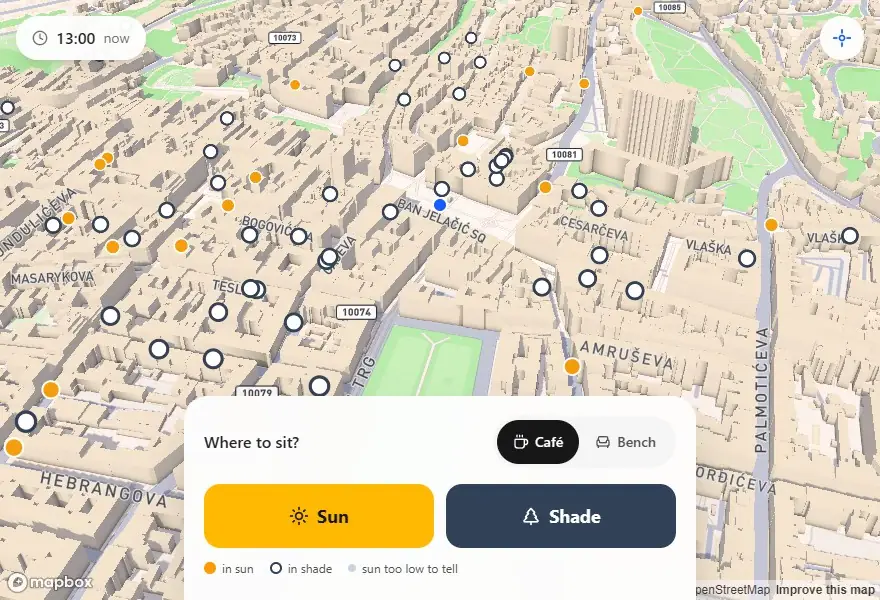

# sada

Sada is Croatian for "now". Tap Sun or Shade and it names the nearest café or bench in the
centre of Zagreb that has it at this moment, says until what time, and draws the walk there.

Live: https://sada-hackathon.vercel.app

[](docs/walkthrough/app-walkthrough.mp4)

In the recording the clock is fixed at 13:00 on 19 September 2026 and the person stands on
the main square. The walking routes in it are answers the routing service gave once, kept in
`scripts/walkthrough-routes.json`. `npm run walkthrough` makes it again.

Sun and shade are worked out from the city's 3D building model and the position of the sun.
Nothing else casts a shadow here. Trees, awnings, parasols and clouds do not exist for this
app, so a bench under a plane tree in a park reads as sun. It covers a box of about 2.3 by
1.3 km around the main square, with 8,732 buildings, 147 cafés and 342 benches. Outside
that box it gives no answer.

## What you get

- **The pick.** The nearest place of the kind you asked for that is in the light you asked
  for and keeps it for at least 20 minutes. If none lasts that long, the nearest that has it
  now.
- **A headline** such as "Sun until 13:32", and under it how long that is and how far the
  walk is.
- **The city in 3D, lit from where the sun stands** at the moment shown, so the shadows
  fall where the answer says they do. A dot marks every café or bench: filled for sun, a
  ring for shade, small and grey where the app cannot tell.
- **A clock** you can move from twelve hours back to a day ahead. The shadows and the pick
  follow it.

## How the answer is worked out

Each building is treated as a flat-roofed block: its footprint, raised from the ground to
the highest point of its roof. For a point on the ground, the app follows a line from that
point toward the sun and looks for the first footprint the line enters. If the roof there
is higher than the line at that distance, the point is in shade. A point under a roof is in
shade. A spatial index keeps this to the few buildings that lie along the line.

"Until when" is the same question asked again for each minute ahead, up to sunset.

The map draws the same blocks. The base map's own buildings are switched off, the blocks
are drawn in their place, and one light is put where the sun stands, so the shadows on
screen are cast by the buildings the answer was worked out from.

All of it runs in a web worker in the browser. There is no server. The pages are static
files, and the one outside service is Mapbox, for the map and for the walking route. When
a route is asked for, the two ends of it go to Mapbox, and one of them is where you are.

## Where the seats are

OpenStreetMap marks most cafés as a point inside their building, where it is always shade.
For a place mapped under a roof, the app judges a point 2 m outside the nearest wall that
has open ground in front of it. Walls shared with the next building are skipped. Of the
147 cafés, 126 are moved this way and 5 are left out because none of their walls opens
onto free ground.

This is an assumption. Where the tables really stand is not mapped, and the app says so
under every pick it applies to.

## What it gets wrong

- **Roofs are flat blocks at their highest point.** A pitched roof casts a slightly longer
  shadow here than in the street, and a church is as tall as its spire over its whole
  footprint.
- **There is no terrain model.** Ground level is taken from the base of each building's 3D
  solid and checked against a plane through its neighbours' bases. For 771 of the 8,732
  buildings the base was more than 3 m off and was replaced by the plane. 55 buildings end
  up no higher than the ground around them and cast nothing.
- **Most of the model is old.** 6,452 buildings (74%) come from a 2008 aerial survey and
  2,280 from a 2022 survey. Anything built or pulled down since is wrong.
- **3 records in the source outline whole blocks.** They have no 3D solid, and each
  holds about a hundred buildings that are in the data on their own. They are left out;
  kept, each would stand as one block over every street and courtyard inside it.
- **The map is flat and its shadows are not the tested part.** Blocks stand on a level
  plane at their height above their own ground, and the graphics card casts their shadows.
  The answer uses the ground level at the seat. On the slope of the upper town a drawn
  shadow can end a few metres from where the answer changes. The tests cover the answers.
- **Low sun near the edge of the box is left open.** If no mapped building blocks the sun
  but the box ends before a 30 m building beyond it could be ruled out, the place shows as
  "sun too low to tell" and is never picked.
- **One sun for the whole box.** Its position is taken at the centre, without atmospheric
  refraction. Across the box it differs by less than 0.05 degrees.
- **The places are a snapshot** of OpenStreetMap from 2026-11-18. A café that closed since
  is still listed, and opening hours are not looked at.
- **Without a walking route** the app shows the straight-line distance and says that it is
  straight-line.
- **Browsers from before 2023** may lack `DecompressionStream`, which unpacks the
  buildings. There the app says the buildings did not load.

## Run it

Node 24.

```bash
npm ci
npm run dev
```

That is enough to get answers. For the map and walking routes, copy `.env.example` to
`.env.local` and put a public Mapbox token in it.

## Check it

```bash
npm test
npm run build
npx playwright install chromium
npm run smoke
```

`npm test` covers the geometry on cases with a known answer (a 10 m block with the sun 45
degrees up, an L-shaped footprint, a courtyard, the compass bearing of the sun through a
day), compares the fast query with a second method on the real buildings, and rebuilds the
building bundle from its source to check it is the committed one byte for byte.

`npm run smoke` opens the built app in a browser at phone and desktop size with the clock
fixed, and checks the pick, the words under it, the clock, and what the app says when it
has no location, when you are far from Zagreb, when the buildings do not load, and at
night.

`npm run walkthrough` builds the app and records `docs/walkthrough`. It needs the Mapbox
token, ffmpeg on the PATH, and a Chromium that draws with the graphics card.

To rebuild the data:

```bash
npm run build:data     # public/data/buildings.bin.gz and its manifest, from data/source
npm run fetch:places   # data/osm/places.json, from OpenStreetMap
```

The building bundle is 583 kB, and 366 kB as it is sent, gzip-compressed.

## Data

- Buildings: ZG3D 2022 3D model Grada Zagreba, Grad Zagreb, under the Open Licence
  (Otvorena dozvola).
- Cafés and benches: © OpenStreetMap contributors, Open Database License.
- Map and routes: Mapbox.

Sources, licences and what was done to each are in
[THIRD_PARTY_NOTICES.md](THIRD_PARTY_NOTICES.md).

## Authors

First built at the Zagreb Hackathon in March 2026 by Francesco Marko Livaic and Antonio
Brkić ([@Brkic365](https://github.com/Brkic365)).

## License

MIT, see [LICENSE](LICENSE). The data keeps its own licences, listed in
[THIRD_PARTY_NOTICES.md](THIRD_PARTY_NOTICES.md).
